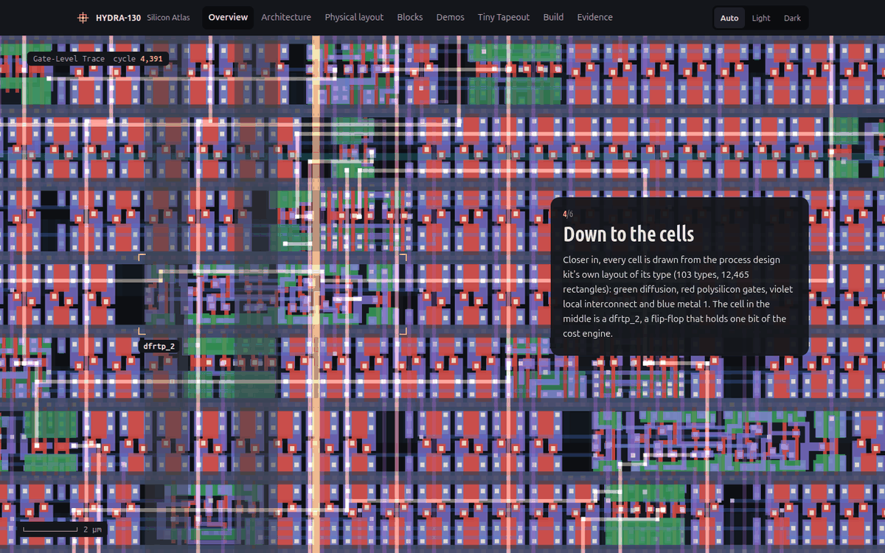
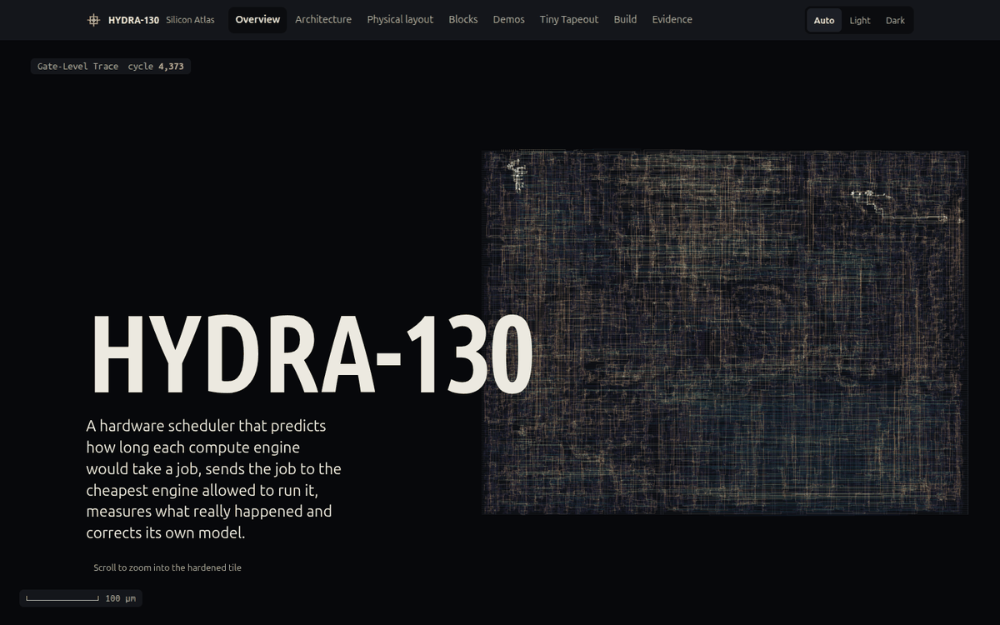
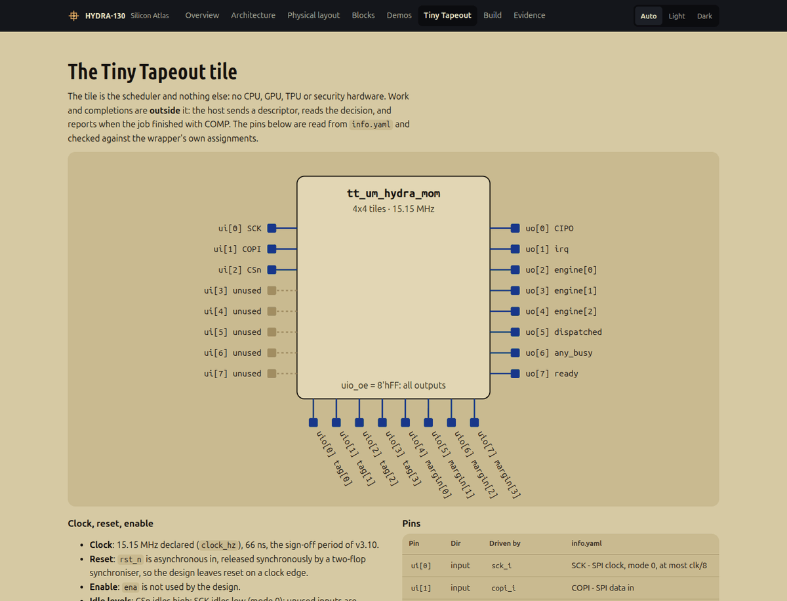
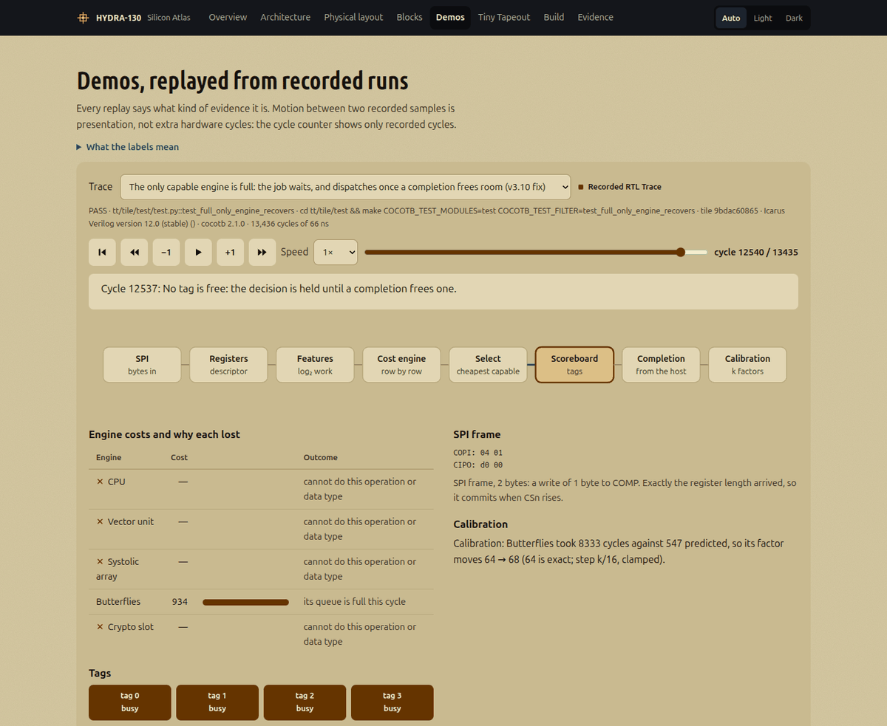

  

# TinyTapeout-Hydra: a self-calibrating hardware scheduler

This is the scheduler from [HYDRA-130](https://github.com/Normansrule/hydra-skywater130), cut down to fit a Tiny
Tapeout tile and nothing more. It asks one question on as little silicon as it takes: can a hardware scheduler
predict how long a job would take on five different engines, pick the cheapest, then measure what actually
happened and correct its own model, with no firmware in the loop? You talk to it over three serial peripheral
interface (SPI) pins: hand it a job, read the decision, tell it when the job finished. It's for anyone who wants
to try hardware scheduling on a real chip from the Tiny Tapeout shuttle, or who's curious what a self-correcting
cost model looks like in a few thousand standard cells.

[Zoom into this tile](https://normansrule.github.io/hydra-skywater130/) ·
[Explore its layout](https://normansrule.github.io/hydra-skywater130/#layout) ·
[Its pins and registers](https://normansrule.github.io/hydra-skywater130/#tile) ·
[Replay a decision](https://normansrule.github.io/hydra-skywater130/#demos/crossover/4391) ·
[Set it up](#setup-and-usage) ·
[Evidence](#evidence) ·
Maintained by [@Normansrule](https://github.com/Normansrule)

> **Where things stand, by revision.** This tile is the **scheduler only**: no central processing unit (CPU),
> graphics processing unit (GPU), tensor processing unit (TPU), vector, transform or security hardware is on it.
> The engines it chooses between are outside it, and the host reports when a job finished. The **v3.10** harden
> (2026-10-18, one LibreLane run at 4×4 tiles, 66 ns) signed off with design rules, layout versus schematic and
> antenna clean and timing met at all nine corners, and all 22 tests pass on its netlist. It still has **1,230
> slew warnings** at the slowest corner. A signed-off layout is not fabricated or tested silicon.

<p align="center">
<picture>
  <source media="(prefers-color-scheme: dark)" srcset="docs/img/tile_hero.dark.svg">
  
</picture>
</p>

## Key features

- **A roofline cost model for five engines.** Compute time against operand traffic per engine, plus queue depth
  and an energy term, evaluated by one shared cost engine walking the five rows of its engine table, two cycles
  each. A decision takes about 13 cycles.
- **Refuses before it compares.** An engine that can't perform the operation or represent the data type is out
  before any cost is compared, and a descriptor no engine can run is reported and retired, never retried.
- **Calibrates itself.** Each completion moves that engine's 8-bit factor (64 means the prediction was exact) one
  step toward the measured time, so a slow engine gets more expensive until the decision moves.
- **Four tags, with back-pressure.** Tags are handed out lowest-free first; with all four in flight the tile holds
  work and drops `ready`. Since v3.10 a job whose only capable engine is full waits and dispatches once a
  completion frees room (it used to hang).
- **A register map you can poke.** 13 registers over SPI mode 0: stage a 16-byte descriptor, GO, read RESULT,
  report COMP, retune any engine's parameters, freeze or reset calibration. A malformed frame changes nothing.
- **Status on the pins.** The last engine, the tag, a log-scaled margin, `ready`, `busy` and an interrupt are
  readable without any SPI traffic.

## Screenshots

The [Silicon Atlas](https://normansrule.github.io/hydra-skywater130/) opens on this tile's own routed layout from
the v3.10 harden and zooms in while one decision plays on it. Each wire glows while its net is high in a
gate-level simulation of the hardened netlist. First the dispatch logic's cells, coloured by the RTL block each
belongs to:

<picture>
  <source media="(prefers-color-scheme: dark)" srcset="docs/img/atlas-dispatch.dark.png">
  
</picture>

Then down to single cells, drawn from the process design kit's own layout of each type:

<picture>
  <source media="(prefers-color-scheme: dark)" srcset="docs/img/atlas-cells.dark.png">
  
</picture>

Then the mask pulled apart: the cells and the four metal layers of this tile as a turning 3D stack:

<picture>
  <source media="(prefers-color-scheme: dark)" srcset="docs/img/atlas-exploded.dark.png">
  
</picture>

And back out to the whole tile, with every net that is high at the select glowing:

<picture>
  <source media="(prefers-color-scheme: dark)" srcset="docs/img/atlas-switched.dark.png">
  
</picture>

The same layout is a free explorer: zoom, step through the recorded cycles, switch layers, select a wire to name
its net, or find one by name.

<picture>
  <source media="(prefers-color-scheme: dark)" srcset="docs/img/atlas-layout.dark.png">
  
</picture>

The tile tab of the [Silicon Atlas](https://normansrule.github.io/hydra-skywater130/#tile): pins read from
`info.yaml` and checked against the wrapper, the register map read from the decode, and a worked SPI session made
of real recorded frames, a refused one included.

<picture>
  <source media="(prefers-color-scheme: dark)" srcset="docs/img/atlas-tile.dark.png">
  
</picture>

One recorded decision, as a short preview:

<picture>
  <source media="(prefers-color-scheme: dark)" srcset="docs/img/demo_dispatch.dark.gif">
  
</picture>

The v3.10 fix, replayed: the only capable engine is full, the job waits, and it dispatches the moment a
completion frees a tag.

<picture>
  <source media="(prefers-color-scheme: dark)" srcset="docs/img/atlas-recovery.dark.png">
  
</picture>

## Setup and usage

**On the Tiny Tapeout demo board.** Select `tt_um_hydra_mom` and drive SPI on `ui[0]` (SCK), `ui[1]` (COPI) and
`ui[2]` (CSn, idle high). Write the 16-byte descriptor to register `0x01`, write `0x01` to `0x03` (GO), read the
result from `0x06`, and report the completion by writing its tag to `0x04` (COMP). Keep SCK at or below clk/8.
Software written for v2's register personality works unchanged: v3 ignores the reset strap; only the ID
(`HYM3`), the tag count and the missing LASTWD register differ.

**In simulation.** The tests are cocotb (a Python testbench framework) on Icarus Verilog, against the submitted
`src/project.v`:

```bash
cd ~/src/tinytapeout-hydra/test && make
```

The same 22 tests on the hardened netlist, and the whole suite with the chip-side checks, run from the parent
repository:

```bash
cd ~/src/hydra-skywater130 && make tile tile-gl
```

After editing `src/rtl/`, regenerate the submitted file and lint it the way LibreLane does:

```bash
cd ~/src/tinytapeout-hydra/src && ./regen.sh > project.v && cd ~/src/hydra-skywater130 && make lint
```

## Project structure

```text
tinytapeout-hydra/
├── info.yaml              Tiny Tapeout metadata: top module, tiles, clock, pin descriptions
├── src/
│   ├── tt_um_hydra_mom.sv the wrapper: pins, reset synchroniser, SPI slave, register map, scheduler
│   ├── rtl/               the scheduler modules (byte-identical to the parent's mom/rtl copies)
│   ├── project.v          the submitted Verilog-2005, generated by regen.sh with sv2v
│   └── config.json        LibreLane settings for the harden
├── test/                  the cocotb suite (test.py, test_regs.py), tb.v and the mutation script
└── docs/
    ├── info.md            the Tiny Tapeout datasheet page
    ├── hardening-history.md  every harden since v2, kept in full
    └── img/               figures, light (.svg) and dark (.dark.svg), the layout render and screenshots
```

## Design

The README figures and the atlas share one concept, the **mask room**: a lithography room is lit by an amber
safelight and the mask is chrome on quartz, so the light theme is the warm, nearly monochrome room, the dark theme
is the mask, and the layout is always drawn as a mask. The colours that mean something are sky130 layer colours
(metal-1 blue for data moving, safelight amber for control and decisions, metal-2 violet for compute, diffusion
green for memory), each with a drawn shape, so colour is never the only cue. Ubuntu Sans condensed for headings and
at normal width for reading, its mono only for signal names and bytes. Motion is physical and only where it
informs: the layout's camera rides a critically damped spring, a switching wire flashes and fades, and reduced
motion turns all of it off. The figures are drawn from the sources: the layout from the harden's DEF and the
process design kit's cell drawings, the glowing wires from a gate-level run of this netlist, the pin figure from
`info.yaml`, the as-built figure from the modules the compiler elaborated. The engine boxes in the lead figure are
rows of the cost table, drawn dashed, because no engine is on this tile.

## Inside

<picture>
  <source media="(prefers-color-scheme: dark)" srcset="docs/img/architecture.dark.svg">
  
</picture>

As built, and nothing more: the pins, a reset synchroniser, the SPI slave, the register map, features, the engine
table, one shared cost engine, select, a 4-tag scoreboard and calibration. There are no compute engines and no
crossbar on the tile.

## Evidence


*The v3.10 layout (harden ladder run 20261018-174736): every standard cell and wire, rendered from the hardened GDS
by Tiny Tapeout's own tool (`make render-layout` in the parent). A layout, not fabricated silicon.*

<picture>
  <source media="(prefers-color-scheme: dark)" srcset="docs/img/timing.dark.svg">
  
</picture>

| check | result |
|---|---|
| Tile tests on RTL (`make tile` in the parent) | **22 / 22** |
| Deliberate breaks (`test/mutate_sim.py`) | each caught by the test named for it |
| v3.10 harden, 2026-10-18 (the scheduler liveness fix) | sign-off clean: DRC, LVS, antenna 0; setup +14.06 ns (v3.10), hold +0.105 ns worst corner; 48.6% of the core; **slew 1,230 / 819 / 557** at the slow corners and 21 / 11 / 11 at the typical corners, 0 capacitance |
| Gate level on the v3.10 netlist | **22 / 22** (the new test is `test_full_only_engine_recovers`) |
| Verilator `-Wall` on `src/project.v` | **0 warnings** |

All nine corners of every harden are in the parent's `docs/timing.json`. Every harden since v2, including the ones
that failed or were rejected, is in [docs/hardening-history.md](docs/hardening-history.md), with the reasoning for
each settings change.

## Part of HYDRA-130

Everything below lives in [hydra-skywater130](https://github.com/Normansrule/hydra-skywater130), **not on this
tile**, and none of it is in a hardened chip yet: a 4×4 INT8 systolic array and a 4-lane vector unit fed from
memory; number-theoretic transform butterflies at the ML-KEM, ML-DSA and Falcon moduli; the Pixelstorm GPU and the
Sixfold RV64 CPU as scheduler slots of a system-tile simulation; a key vault, mailbox, SHA-256 and measurement
register, each proved and checked on its own and in no build; RISC-V security instructions; and an IEEE 1149.1 test
port on the Basys 3 image.

## Licence and maintainer

Apache 2.0 (see `LICENSE`). Author: Aleksander J. Norman. Maintained by
[@Normansrule](https://github.com/Normansrule) ([MAINTAINERS.md](MAINTAINERS.md)). Designed for the Tiny Tapeout
shuttle on the SkyWater sky130 process; it has not been fabricated.
