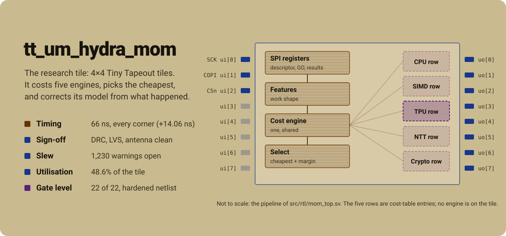
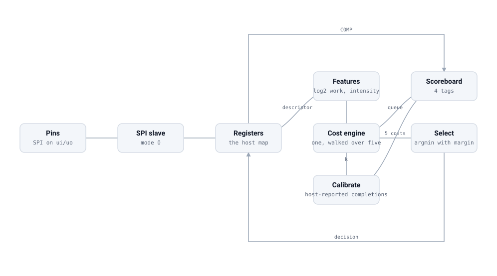
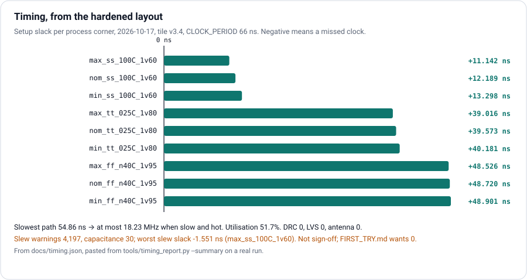

  

# TinyTapeout-Hydra: a self-calibrating hardware scheduler

**One question, on as little silicon as it takes to answer it: can a hardware scheduler predict how long work
would take on five different engines, choose the cheapest, then measure what actually happened and correct its
own model, with no firmware in the loop?**

[Explore the tile](https://normansrule.github.io/hydra-skywater130/#tile) ·
[Replay a decision](https://normansrule.github.io/hydra-skywater130/#demos) ·
[Pins and registers](#pins) ·
[How to test](#how-to-test) ·
[Evidence](#evidence) ·
Maintained by [@Normansrule](https://github.com/Normansrule)

> **Status, by revision.** This tile is the **scheduler only**: no CPU, GPU, TPU, vector, transform or security
> hardware is on it; the engines it chooses between are outside it, and the host reports when a job finished.
> The **v3.10** harden (2026-10-18, one LibreLane run at 4×4 tiles, 66 ns) signed off with design rules, layout
> versus schematic and antenna clean and timing met at all nine corners, and all 22 tests pass on its netlist.
> It still has **1,230 slew warnings** at the slowest corner. A signed-off layout is not fabricated or tested silicon.

<picture>
  <source media="(prefers-color-scheme: dark)" srcset="docs/img/tile_hero.dark.svg">
  
</picture>

## One decision, replayed

<picture>
  <source media="(prefers-color-scheme: dark)" srcset="docs/img/demo_dispatch.dark.gif">
  
</picture>

Give the tile a unit of work (a matrix multiply, a vector operation, a polynomial transform) and it costs each of
five engines with a roofline model, refuses the engines that cannot run it, picks the cheapest, hands out a tag,
and when the host reports the completion, moves a per-engine, per-operation factor toward the measured time. The
frames above are drawn from a recorded run of `test/test.py::test_roofline_crossover` on `src/project.v`; the
[Silicon Atlas](https://normansrule.github.io/hydra-skywater130/#demos) replays it and seven more of this tile's
tests (tag exhaustion, stale completions, calibration closing the loop, torn SPI frames, reset mid-frame, an
unsupported descriptor, and the v3.10 fix: a job whose only capable engine is full now waits and dispatches once a
completion frees room) with captions and waveforms.

| | |
|---|---|
| **Engines it chooses between** | scalar CPU · SIMD vector unit · 4×4 INT8 systolic array · number-theoretic transform · crypto datapath (none on this tile) |
| **Cost model** | roofline: compute time against operand traffic per engine, plus queue depth and an energy term |
| **Calibration** | each completion compares the measured duration with the prediction; an 8-bit factor (64 = exact) steps toward it |
| **Decision latency** | about 13 cycles: one shared cost engine evaluates all five rows, two cycles each |
| **Interface** | SPI register map, mode 0, three pins; status summaries on the outputs |
| **Clock** | 15.15 MHz (66 ns), the sign-off period |
| **Tiles** | 4 × 4 |
| **Tags in flight** | 4 |

## Pins

<picture>
  <source media="(prefers-color-scheme: dark)" srcset="docs/img/pinout.dark.svg">
  
</picture>

Generated from [`info.yaml`](info.yaml) and checked against the wrapper's own assignments in
[`src/tt_um_hydra_mom.sv`](src/tt_um_hydra_mom.sv). CSn idles high and SCK idles low (mode 0, at most clk/8);
`ui[7:3]` are ignored; every `uio` pin is an output. `rst_n` is asynchronous in and released by a two-flop
synchroniser; `ena` is not used.

The register map (13 registers, from the decode in [`src/rtl/hydra_tt_regs.sv`](src/rtl/hydra_tt_regs.sv)): a
frame is a command byte `{rw, addr[6:0]}` followed by the register's bytes, most significant first; a write
commits when CSn rises and only if exactly the register's length arrived, otherwise nothing changes and
FRAME_ERR is set. [`docs/info.md`](docs/info.md) has the full map and a worked example; the
[atlas](https://normansrule.github.io/hydra-skywater130/#tile) lists every register and replays real SPI frames,
including a refused one.

## Inside

<picture>
  <source media="(prefers-color-scheme: dark)" srcset="docs/img/architecture.dark.svg">
  
</picture>

As built, and nothing more: the pins, a reset synchroniser, the SPI slave, the register map, features, the
engine table, one shared cost engine, select, a 4-tag scoreboard and calibration. Each box is a module the
compiler elaborated from the submitted `src/project.v`. There are no compute engines and no crossbar on the tile.

**One cost engine doing the work of five.** The five engines differ only in their parameters, so a single engine
walked over the five parameter rows computes the same costs in more cycles and about a fifth of the area: the
change that took this tile from failing placement at 98.8% density to a clean harden. The parent repository
proves the shared version makes **the same decision** as the parallel one on every descriptor it is given.

## Evidence

*The v3.10 layout (harden ladder run 20261018-174736): every standard cell and wire, rendered from the hardened GDS
by Tiny Tapeout's own tool (`make render-layout` in the parent). A layout, not fabricated silicon.*

<picture>
  <source media="(prefers-color-scheme: dark)" srcset="docs/img/timing.dark.svg">
  
</picture>

| check | result |
|---|---|
| Tile tests on RTL (`make tile` in the parent) | **22 / 22** |
| Deliberate breaks (`test/mutate_sim.py`) | each caught by the test named for it |
| v3.10 harden, 2026-10-18 (the scheduler liveness fix) | sign-off clean: DRC, LVS, antenna 0; setup +14.06 ns (v3.10), hold +0.105 ns worst corner; 48.6% of the core; **slew 1,230 / 819 / 557** at the slow corners and 21 / 11 / 11 at the typical corners, 0 capacitance |
| Gate level on the v3.10 netlist | **22 / 22** (the new test is `test_full_only_engine_recovers`) |
| Verilator `-Wall` on `src/project.v` | **0 warnings** |

All nine corners of every harden are in the parent's `docs/timing.json`. Every harden since v2, including the ones
that failed or were rejected, is in [docs/hardening-history.md](docs/hardening-history.md), with the reasoning for
each settings change. The cell-level placement of the latest mapped run, coloured by the RTL instance each cell
belongs to (by netlist names, never by drawn regions), is on the atlas's
[Physical layout](https://normansrule.github.io/hydra-skywater130/#layout) tab.

## How to test

With the Tiny Tapeout demo board, select `tt_um_hydra_mom` and drive SPI on `ui[0]` (SCK), `ui[1]` (COPI) and
`ui[2]` (CSn). Write the 16-byte descriptor to register `0x01`, write `0x01` to `0x03` (GO), read the result from
`0x06`, and report the completion by writing the tag to `0x04` (COMP). Software written for v2's register
personality works unchanged: v3 ignores the reset strap. Only the ID (`HYM3`), the tag count and the missing
LASTWD register differ.

## Part of HYDRA-130

This tile is the scheduler from a larger design. Everything below lives in
[hydra-skywater130](https://github.com/Normansrule/hydra-skywater130), **not on this tile**, and none of it is in
a hardened chip yet: a 4×4 INT8 systolic array and a 4-lane vector unit fed from memory; number-theoretic transform
butterflies at the ML-KEM, ML-DSA and Falcon moduli; the Pixelstorm GPU and the Sixfold RV64 CPU as scheduler
slots of a system-tile simulation; a key vault, mailbox, SHA-256 and measurement register, each proved and checked
on its own and in no build; RISC-V security instructions; and an IEEE 1149.1 test port on the Basys 3 image. The
parent's `make verify` checks that the modules this tile shares with the chip are byte-identical, so the chip's
verification of them covers this tile too.

## Licence and maintainer

Apache 2.0 (see `LICENSE`). Author: Aleksander J. Norman. Maintained by
[@Normansrule](https://github.com/Normansrule) ([MAINTAINERS.md](MAINTAINERS.md)). Designed for the Tiny Tapeout
shuttle on the SkyWater sky130 process; it has not been fabricated.
