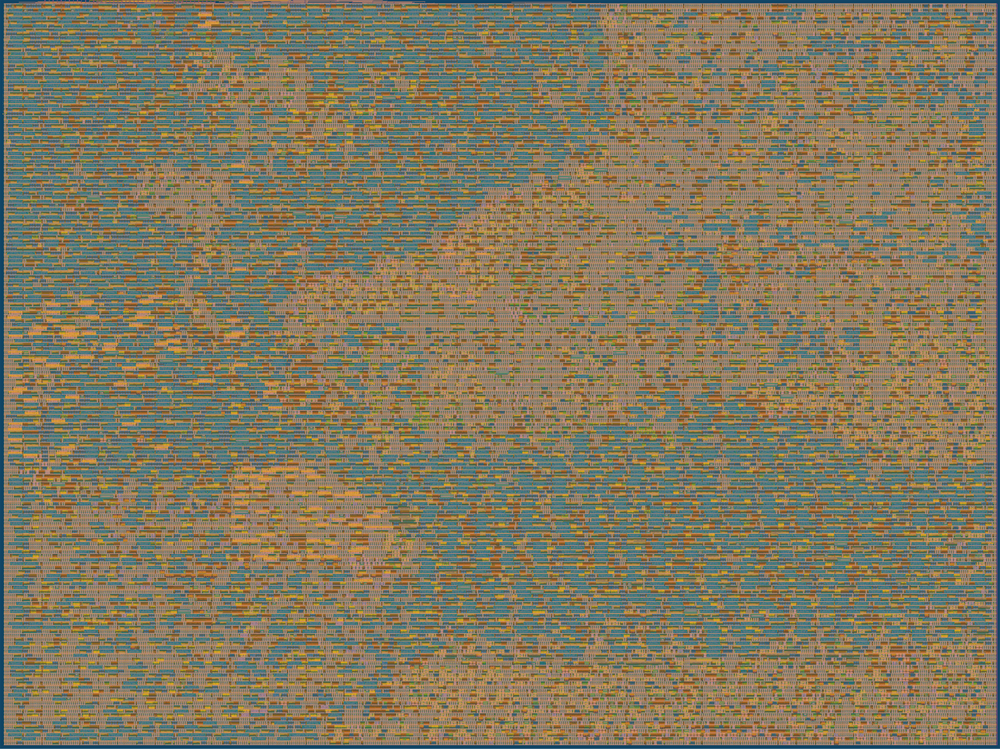

# Hardening history of the research tile

Moved here from the README on 2026-10-18 when the README was rewritten; the text is unchanged. Each entry is dated and names its revision. Numbers of one revision are not evidence for another.

## Status, as written before the README rewrite

**v3.1 (2026-10-11) needs a new harden.** Two protocol fixes from the second
engineering audit (R7) change the netlist. A descriptor write that arrives
while a GO is pending is now refused as a frame error instead of changing the
pending descriptor. A fence on a tag that does not exist now reads as not
busy instead of indexing past the busy vector. A second audit (SkyWater 130,
2026-10-11) changed the shared scheduler modules as well. The cost engine's
normalisation could drop a prediction by half (511 became 256); it is now
within 1/256 of the exact product. The calibrator's comparison could wrap
and move a factor the wrong way, and an out-of-range update could overwrite
another engine's factor; both are fixed. Multi-byte reads are now a single
snapshot. Each fix has a test that failed before it. Every harden below
predates all of these. The audit reports that the
tile's GitHub GDS workflow for commit `452a59a4` (2026-10-09) succeeded; that
run's logs have not been reviewed for this README, so it is not counted below.

**v3 has been hardened once, at the wrong size, and passed.** The first v3
run (2026-10-10) came out 4×4 instead of 3×4: `--harden` builds from
`src/user_config.json`, which still said 4×4. On that die it signed off clean
— design rules, layout versus schematic and antenna passed, no setup or hold
violations at any corner — with cells filling 52% of the core, and **all 18
tests pass on its netlist**. So the fallback is already proven. The 3×4
harden is next; `tools/tile_size_check.py` now stops a harden or a gate-level
run on the wrong size.

**v3.2 (2026-10-13) goes back to 4×4.** The 3×4 harden of v3.1 did not
route: detailed routing went 10,085, 5,223, 4,558, 4,338, 4,190 violations
over successive iterations, each removing less than the one before (read
from the run's log on 2026-10-13). Sign-off needs exactly 0, and at that rate
thousands would be left at the 64-iteration limit. `make drt-progress` in the
parent repository now reads a running harden and says whether it is on
course. At 3×4 the cells fill about 70% of the core, routed on met1
to met4 only, and global routing is allowed to pass congestion on to detailed
routing, which then cannot clear it. At 4×4 the same design signed off clean
at 52%. `src/config.json` returns the placement density target to the
template's 60. It also raises the design-repair slew and capacitance margins
from 20% to 50%, because every harden so far ended with about 5,000 slow-corner
slew warnings: repair sizes buffers at the typical corner only.

**v3.2 hardened clean on 2026-10-14** at 4×4: design rules, layout versus
schematic and antenna all 0; setup met at every corner with **+5.62 ns** worst
slack at 66 ns (v2: +2.20); hold met, worst +0.106 ns; cells 53.5% of the core;
detailed routing 971 → 245 → 196 → 10 → 0; **21 / 21 tests pass on the
hardened netlist**. The 50% margins took the slew warnings only from about
5,000 to 3,665 (11 capacitance). `tools/slew_report.py` showed why: every one
of the worst nets, at the slow and the typical corner, is driven by a fanout
buffer the resizer built from `clkdlybuf4s25_1`, a clock delay cell that is
weak by design, each driving 10 to 15 loads (1,093 of them). **v3.3** excludes
that cell family (`EXTRA_EXCLUDED_CELLS`) so fanout trees use real buffers.
Its first harden, still at 50% margins, confirmed the change took effect
(input buffers became `buf_1`) but then hung in the post-placement repair
step for over a day. **v3.4** returns the margins to the default 20% and keeps
the exclusion; `make harden` in the parent repository runs it unattended,
stops a run that stalls for an hour and falls back to the pre-v3.2 settings.
**It signed off on the first configuration on 2026-10-17**, in 11 minutes:
design rules, layout versus schematic and antenna 0, setup met at every corner
with **+11.14 ns** worst slack (v3.2: +5.62), hold +0.107 ns, 51.7% of the
core, 21 / 21 tests on its netlist. Slew is not fixed yet: the run's
`checks.out` reports **4,197** max-slew warnings at the slow corner (worst
-1.551 ns) and 635 at the typical corner (worst -0.633 ns), plus 30
capacitance warnings (v3.2 at 50% margins: 3,665 and 11). The delay cells are
gone; every one of the worst nets is now a `buf_1` fanout buffer driving 10
to 13 loads. All nine corners are in the parent repository's `docs/timing.json`.

**v3.5** also excluded `buf_1` and `clkbuf_1`: the resizer used the
`dlygate4sd3_1` delay gate instead and setup failed by 2.403 ns, so it was
rejected. **v3.6 signed off clean on 2026-10-17** with every weak and delay
buffer excluded (`buf_1`, `clkbuf_1`, `dlygate4sd*`, `dlymetal6s*`,
`clkdlybuf4s*`): setup **+14.84 ns** (v3.6) at every corner, hold +0.106 ns,
48.9% of the core, slew warnings 4,197 → **775**, only at the three slow
corners, capacitance 30 → **0**, and 21 / 21 tests on its netlist.

The submitted `src/project.v` is now Verilator `-Wall` clean with LibreLane's
lint settings: 0 warnings, down from 93 (widths made explicit, unused bits
consumed by name, constants that sv2v copies in and never uses filtered out
by `src/regen.sh`). None of these changes the logic; the 21 tests and 17
deliberate breaks re-run on it.

The last signed-off harden is v2's, the same cost model with the parts above
still in it:

*v2's real layout: every standard cell and wire, rendered from the hardened
GDS by Tiny Tapeout's own tool (`./tt/tt_tool.py --create-png`).*

| v2 check, 2026-10-05 | result |
|---|---|
| Hardening, all 80 stages | **complete** |
| Layout versus schematic | **match** — 18,773 devices, 18,637 nets |
| Design rule check (Magic) | **clean** |
| Setup timing at 66 ns | **met at all nine corners** — slow corner slack **+2.20 ns** (v2) |
| Hold timing | **met at all nine corners** |
| Antenna | **clean** — six repair passes cleared the last net |
| Utilisation (v2) | **67.3%** of the 4×4 tile |
| Gate-level simulation | **17 / 17** on the hardened netlist (2026-10-07) |

| v3 check | result |
|---|---|
| Tile tests, RTL (v3.1) | **21 / 21** |
| Deliberate breaks caught (`test/mutate_sim.py`, v3.1) | **17 / 17**, each by the test named for it |
| Harden at 4×4 (by mistake), gate level | sign-off clean · **18 / 18** |
| Harden at 3×4 (v3.1) | did not route: 10,085 → 4,190 detailed-routing violations, not converging; stopped |
| Harden at 4×4 (v3.2), 2026-10-14 | **sign-off clean**: DRC, LVS, antenna 0; setup +5.62 ns, hold +0.106 ns worst corner; 53.5%; 3,665 slew and 11 capacitance warnings |
| Gate level, v3.2 netlist | **21 / 21** |
| Harden with the delay buffers excluded, 50% margins (v3.3) | hung in post-placement repair (net 7,000 of 11,823) for over a day; stopped |
| Harden with the delay buffers excluded, 20% margins (v3.4), 2026-10-17 | **sign-off clean in 11 minutes**: DRC, LVS, antenna 0; setup **+11.14 ns**, hold +0.107 ns worst corner; 51.7%; 4,197 slew and 30 capacitance warnings |
| Gate level, v3.4 netlist | **21 / 21** |
| Harden excluding `buf_1`/`clkbuf_1` too (v3.5), 2026-10-17 | setup **failed** by 2.403 ns (delay gates used instead); rejected |
| Harden with no weak or delay buffers (v3.6), 2026-10-17 | **sign-off clean**: DRC, LVS, antenna 0; setup **+14.84 ns** (v3.6), hold +0.106 ns; 48.9%; 775 slew (slow corners only), 0 capacitance |
| Gate level, v3.6 netlist | **21 / 21** |
| Harden after the engine-count change (v3.7), 2026-10-18 | **sign-off clean**: DRC, LVS, antenna 0; setup +9.39 ns (v3.7), hold +0.107 ns; 48.9%; 1,333 slew (slow corners only), 1 capacitance. The netlist is proved equivalent to v3.6's; the layout differs because the tools saw renamed logic |
| Gate level, v3.7 netlist | **21 / 21** |
| Harden after the ABI-v2 eligibility tie-off (v3.8), 2026-10-18 | **sign-off clean**: DRC, LVS, antenna 0; setup +10.06 ns (v3.8), hold +0.108 ns; 48.7%; 1,164 slew (slow corners only), 0 capacitance. Netlist proved equivalent to v3.7's |
| Gate level, v3.8 netlist | **21 / 21** |
| v3.9, slew repair margin 35% (logic as v3.8), 2026-10-18 | **sign-off clean**: DRC, LVS, antenna 0; setup +10.31 ns, hold +0.107 ns; 49.0%; slew 759 / 480 / 265 at the slow corners and 16 at each typical corner, 0 capacitance; 21/21 gate level. Not adopted: no better than v3.6 and adds typical-corner slew |
| Harden after the scheduler liveness fix (v3.10, v3.6 settings), 2026-10-18 | **sign-off clean**: DRC, LVS, antenna 0; setup +14.06 ns, hold +0.105 ns; 48.6%; slew 1,230 / 819 / 557 at the slow corners and 21 / 11 / 11 at the typical corners, 0 capacitance |
| Gate level, v3.10 netlist | **22 / 22** (the new test is `test_full_only_engine_recovers`) |
| Verilator `-Wall` on `src/project.v` | **0 warnings** (was 93) |
